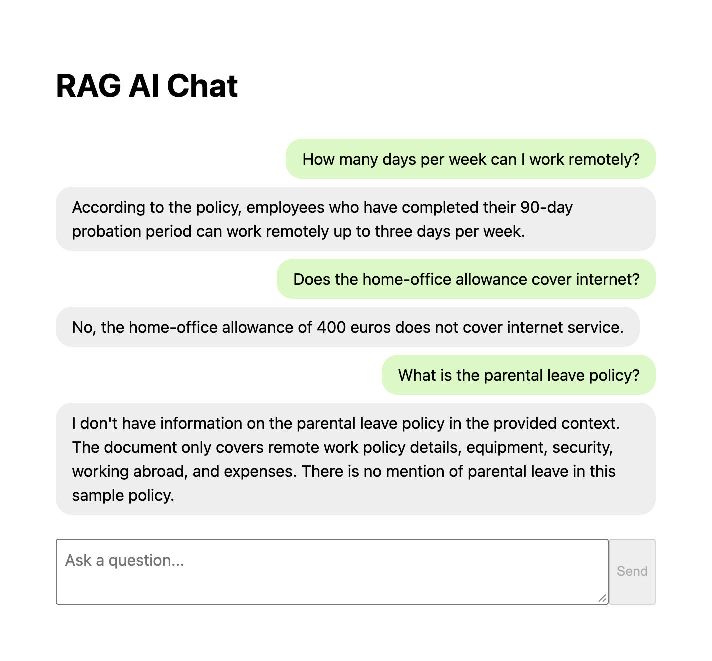
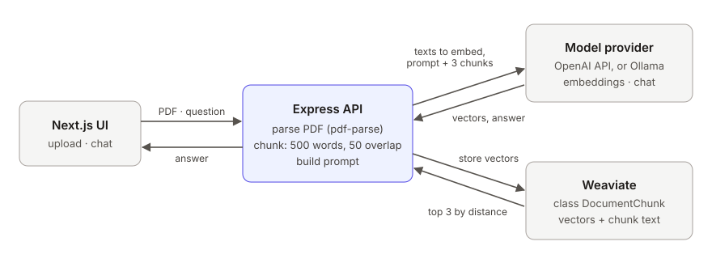

> **Archived (November 2026).** This is an early learning project from 2025, brought back to a working state and then archived as a reference. For retrieval done properly, measured and explained article by article, see [rag-engineering](https://github.com/SnehalAgrawal/rag-engineering) and the articles at [snehalagrawal.com](https://snehalagrawal.com/articles/).

# RAG Chat over PDFs

Upload a PDF and ask questions about it: an Express API embeds the chunks into Weaviate, and a Next.js chat UI answers with an OpenAI model, or with a local model through Ollama.



## What it does

This is a small, complete retrieval-augmented generation (RAG) app:
- **Upload.** The backend extracts the PDF's text, splits it into overlapping chunks, embeds each chunk, and stores the vectors in Weaviate.
- **Ask.** The backend embeds the question, retrieves the three closest chunks, and asks the chat model to answer from those chunks only, admitting when the answer is not there.

## How it works



- **Upload** (`POST /upload`): [`pdf-parse`](https://www.npmjs.com/package/pdf-parse) extracts the text, which is split into chunks of 500 words with a 50-word overlap ([`backend/utils/pdfParser.js`](backend/utils/pdfParser.js)). The chunks are embedded in batches of 100 and written to a Weaviate class called `DocumentChunk` with their vectors ([`backend/routes/upload.js`](backend/routes/upload.js)).
- **Chat** (`POST /chat`): the question is embedded with the same model, Weaviate returns the 3 nearest chunks, and the chat model gets the question plus those chunks ([`backend/routes/chat.js`](backend/routes/chat.js)).
- **Models**: one OpenAI client serves embeddings and chat ([`backend/services/openaiClient.js`](backend/services/openaiClient.js)). Because it reads `OPENAI_BASE_URL`, it also works with any OpenAI-compatible server, such as Ollama.
- **Frontend**: a Next.js page with a PDF upload form that switches to a chat window once the upload succeeds ([`frontend/`](frontend/)).

## Tech stack

| Part | Technology |
|---|---|
| Frontend | Next.js 16 (Pages Router), React 19, axios |
| Backend | Node.js, Express 4, multer (uploads), pdf-parse |
| Vector database | Weaviate 1.40 (Docker), `weaviate-ts-client` |
| Models | OpenAI API (`text-embedding-3-small` and a chat model you choose), or local models through Ollama |

## Run it

Requirements: Node.js 20.9 or newer (tested with 24.16), Docker, and either an OpenAI API key or [Ollama](https://ollama.com).

1. Start Weaviate:

   ```bash
   docker compose up -d
   ```

2. Configure and start the backend:

   ```bash
   cd backend
   cp .env.example .env    # then edit .env (see Configuration)
   npm ci
   npm start               # http://localhost:4000
   ```

3. Start the frontend in a second terminal:

   ```bash
   cd frontend
   npm ci
   npm run dev             # http://localhost:3000
   ```

4. Open http://localhost:3000, upload a PDF (try [`samples/remote-work-policy.pdf`](samples/remote-work-policy.pdf), a short fictional policy written for this demo), and ask a question.

To stop: `Ctrl+C` in both terminals, then `docker compose down` (add `-v` to delete the stored vectors).

### Run without an API key (Ollama)

```bash
ollama pull llama3.2:3b
ollama pull nomic-embed-text
```

Then use the Ollama block in `backend/.env.example` (`OPENAI_BASE_URL=http://localhost:11434/v1`, `CHAT_MODEL=llama3.2:3b`, `EMBEDDING_MODEL=nomic-embed-text`).

## Configuration

All settings live in `backend/.env`:

| Variable | Required | What it does |
|---|---|---|
| `OPENAI_API_KEY` | yes | Your OpenAI key. For Ollama any non-empty value works. |
| `CHAT_MODEL` | yes | The chat model that writes answers. Pick one your account can use; check [OpenAI's deprecations page](https://platform.openai.com/docs/deprecations) first. |
| `EMBEDDING_MODEL` | no | Embedding model. Default: `text-embedding-3-small`. |
| `OPENAI_BASE_URL` | no | Set to use an OpenAI-compatible server instead of OpenAI, e.g. `http://localhost:11434/v1` for Ollama. |
| `WEAVIATE_HOST` | yes | Weaviate URL. Default from `docker-compose.yml`: `http://localhost:8080`. |
| `WEAVIATE_API_KEY` | no | Only for a Weaviate instance with authentication. |
| `PORT` | no | Backend port. Default: `4000`. |

The frontend calls `http://localhost:4000` unless `NEXT_PUBLIC_API_BASE_URL` is set.

## What you'll see

The screenshot above is from a real run on 2026-11-15 with the sample PDF and local models:

- **Machine:** macOS on Apple silicon, Node.js 24.16.0, Docker 29.9.3.
- **Vector database:** Weaviate 1.40.5 (`docker-compose.yml`).
- **Models:** Ollama 0.40.16, with `llama3.2:3b` (ID `a80c4f17acd5`, 3.2B parameters, Q4_K_M) for chat and `nomic-embed-text` (ID `0a109f422b47`) for embeddings.
- **Frontend:** the production build (`next build && next start`), driven by headless Chrome.

The answers are model output, so wording changes from run to run and between models. The sample PDF fits in one chunk, so every question receives the whole document as context.

## Limitations

- **One shared collection.** Every upload goes into the same `DocumentChunk` class, and questions search all uploaded documents together. Uploading the same file twice stores its chunks twice.
- **Changing the embedding model needs a fresh index.** Vectors from different models have different sizes and are not comparable. After changing `EMBEDDING_MODEL`, run `docker compose down -v` and upload again.
- **Simple chunking.** Chunks are counted in words, not tokens, and ignore headings, pages, and tables.
- **No sources in the answer.** The API retrieves chunk distances but the UI does not show which passages the answer came from.
- **No limits.** There is no maximum upload size, no authentication, and CORS is open. Run it locally only.
- **One PDF per page load.** After an upload the form is replaced by the chat window; reload the page to upload another file.
- **Known advisory.** `npm audit` reports a moderate `uuid` advisory through `weaviate-ts-client`, which this app's code doesn't reach. Weaviate's replacement client (`weaviate-client` v3) has a different API, and migrating to it is not done here.

## Changes since the first version

The first version (June 2025) no longer ran as published. These changes, made in November 2026, keep its design:

- **Chat model.** The code called `gpt-4` with a fallback to `gpt-3.5-turbo`, and OpenAI shut down both on 2026-10-23. The model now comes from `CHAT_MODEL`, and a failing call is reported instead of silently retried with another model.
- **Ollama support.** `EMBEDDING_MODEL` and `OPENAI_BASE_URL` were added so the app runs with Ollama and needs no API key.
- **Empty index.** Asking before any upload returns `409 No documents indexed yet` instead of a 500 error.
- **Dependencies.** Next.js was pinned to 16.4.6 (it was `latest`), React to 19.3.1, axios to 1.21.1, and multer to 2.5.0, which cleared the critical and high `npm audit` findings.
- **Images.** Weaviate is pinned to 1.40.5 (it was `latest`), and the backend Dockerfile moved from Node 16 to Node 24.
- **Housekeeping.** `.gitignore`, a sample PDF, an architecture diagram, and a screenshot were added.
